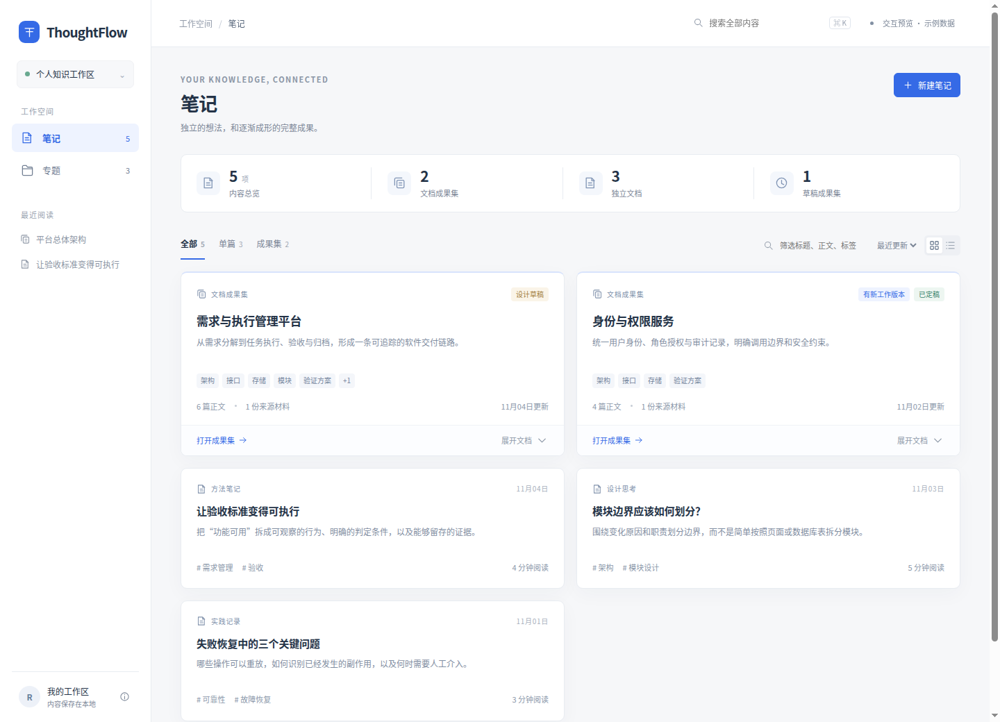
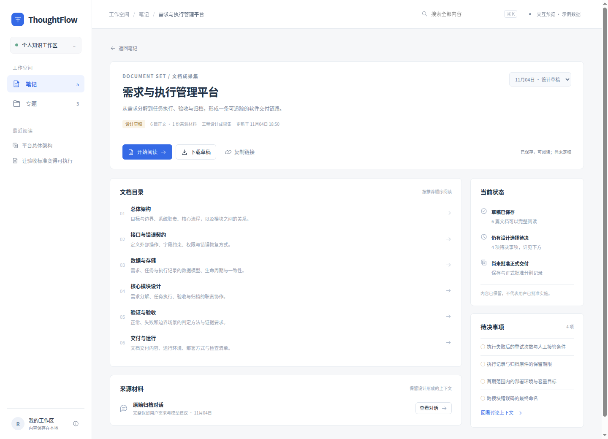
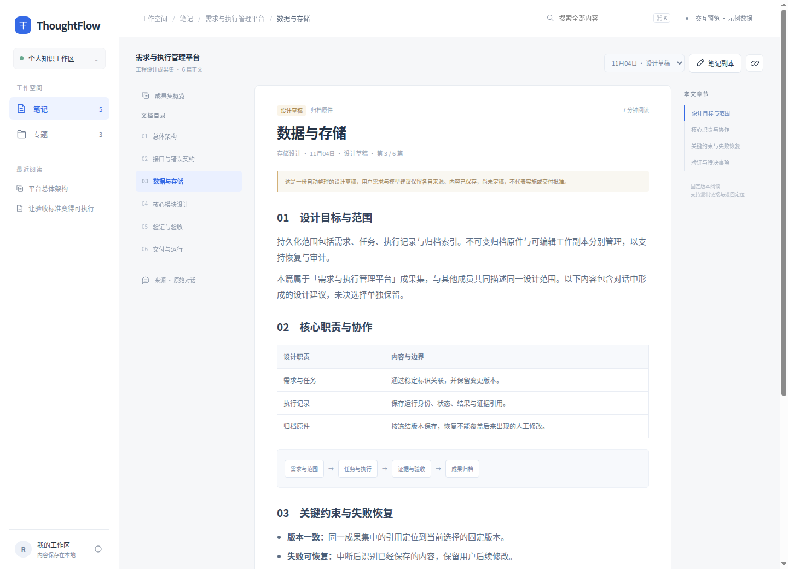
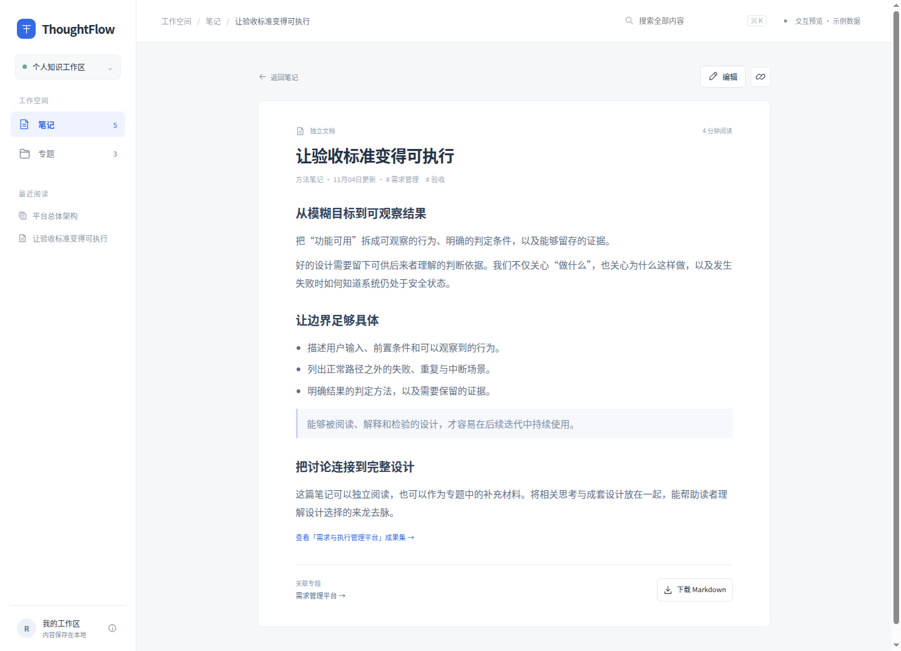
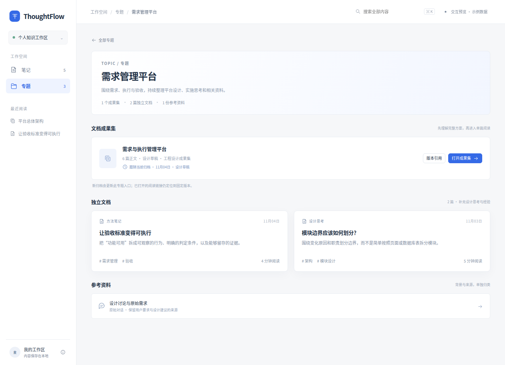
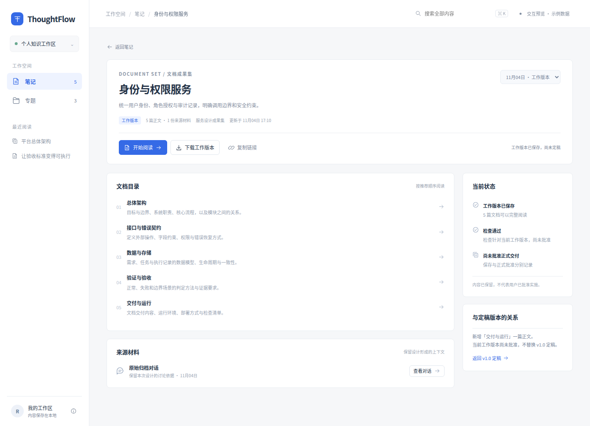
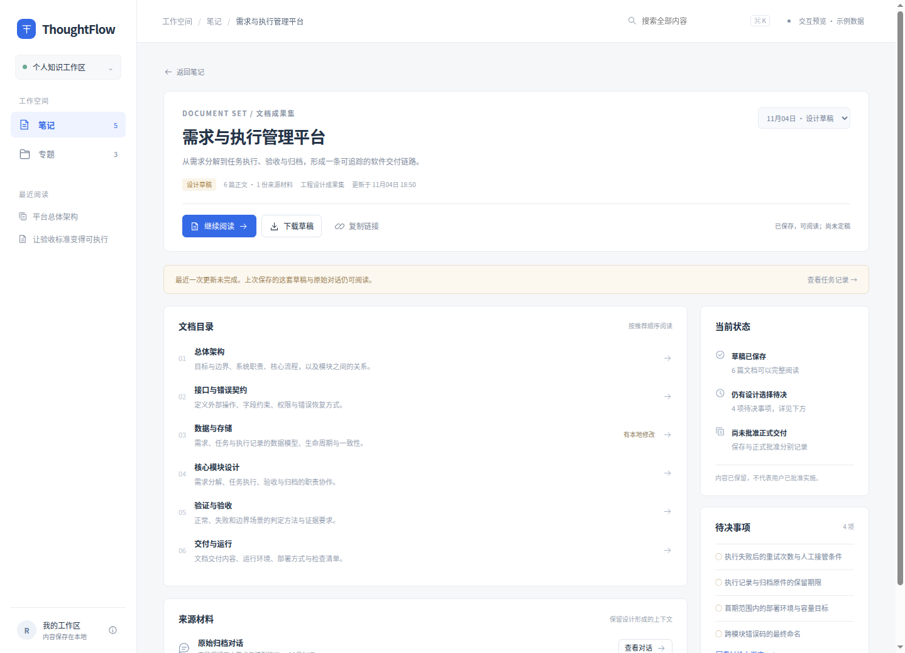

# ThoughtFlow 笔记、专题与文档成果集交互设计 v1

日期：2026-11-04。用于确认交互与视觉效果，尚未接入产品业务接口。

## 1. 查看方式

- [打开独立交互原型](ThoughtFlow-Notes-DocumentSet-Prototype-v1.html)。单个 HTML 文件，直接用浏览器打开即可，不依赖外部字体、网络资源或构建工具。
- 本轮本机预览地址：<http://127.0.0.1:8072/ThoughtFlow-Notes-DocumentSet-Prototype-v1.html>。
- 需要重新启动预览时，在仓库根目录执行：

  ```bash
  python3 -m http.server 8072 --bind 127.0.0.1 --directory doc/interaction
  ```

原型使用示例数据。新建、编辑、专题引用方式和阅读位置仅保留在当前页面内存，刷新后重置；固定页面、成果集版本与章节由 URL 恢复。下载为真实可下载的示例 Markdown。原型不会读取或修改真实笔记、会话、配置、定稿记录，也不调用模型。

## 2. 展示关系

| 对象 | 用户理解 | 默认展示 |
| --- | --- | --- |
| Thought | 一篇可以独立阅读、搜索与引用的文档 | 独立文档显示单篇卡片；成果集成员在所属成果集中展开 |
| 文档成果集 | 围绕一个目标、具有目录与版本的一套内容 | 一张聚合卡片，进入后先看概览，再读成员 |
| 专题 | 围绕长期主题组织内容的空间 | 成果集、独立文档和参考资料分别展示 |

成员关系来自稳定身份，不以相似标题或相同 Profile 自动拼组。一个专题引用成果集时，引用的是整套内容及其版本选择策略。

此次原型保留“笔记”和“专题”两个主导航，不额外增加第三个顶层“成果集”入口。成果集既能在笔记中发现，也能从相关专题进入。

## 3. 页面与交互

### 3.1 笔记：同时容纳单篇与成套内容



- 默认聚合：示例有 2 个成果集、3 篇独立文档，显示 5 项内容。
- 聚合卡片采用业务主题命名，显示草稿／定稿状态、正文篇数、来源材料数量与更新时间。已有定稿但存在新工作版本时，两个信息分别提示。
- “全部／单篇／成果集”筛选保留不同内容类型；支持名称排序和当前列表筛选。
- 点击“展开文档”，可直接进入成员；点击标题或“打开成果集”，进入整套概览。
- 切换“按文件平铺”，示例显示 13 篇正文。原始对话仍归入来源材料，不混入正文计数。
- 独立 Thought 直接打开阅读正文；编辑和下载作为阅读页上的次级操作。

统计口径：聚合时计数为“独立文档数 + 成果集数”，平铺时为正文文件数。计数单位随展示方式变化，不能都称作“笔记数”。

### 3.2 成果集概览：先理解这套内容是什么



顶部显示业务主题、设计目标、内容状态、正文／来源数量和版本选择。主操作是“开始阅读／继续阅读”，并提供草稿或文档下载、固定链接复制。

主体分为：

1. 文档目录：中文名称、一句话说明、推荐顺序；点击进入正文。
2. 当前状态：分别说明是否保存、是否通过检查、是否批准交付。
3. 待决事项：保留已有方案中的边界，不把未决问题变成重复生成前置步骤。
4. 来源材料：原始对话独立呈现，不作为第七篇设计正文。

已有阅读记录时，可继续同一版本的上次成员；首次进入仍能看到概览，避免直接落入某篇而不理解整套范围。

### 3.3 成员阅读：保持整套上下文



桌面采用“成员目录—正文—本文章节”的布局：

- 左侧：概览入口、按顺序排列的成员、原始对话入口。
- 中部：当前文档名称、所属角色、版本、整套中的位置，以及完整正文。
- 右侧：当前文档章节定位。
- 页尾：上一篇／下一篇，第一篇和最后一篇提供回到概览的入口。

切换版本时保留同名成员 key；若目标版本没有该成员，回退到目标版本第一篇并解释。例如从 11月04日的“数据与存储”切到 11月03日，自动打开旧版“总体架构”。用户主动输入的无效内容链接则显示内容不可用，不猜测替换。

阅读链接固定成果集、版本、成员；章节导航还会固定章节。直接打开、刷新和浏览器前进／后退均按该身份恢复，避免混入单篇最新正文。

### 3.4 单篇与笔记副本



独立文档以正文为中心，直接提供编辑、下载、关联专题等操作。处理状态、路径或后台任务不占据正文首屏。

从成果集进入“笔记副本”时：

- 明确标注可编辑副本与其来源版本。
- 编辑前加载完整示例正文，保存后显示“存在本地修改”。
- 随时可以回到固定归档原件；保存副本不改变当前成果集版本或批准状态。
- 原型按来源版本隔离演示副本。产品实施仍须沿现有 Thought 身份与受管成员编辑协议实现，不能直接照搬原型内存字典替代正式数据模型。

### 3.5 专题：整套方案与补充材料共同组织



专题详情按“概览—文档成果集—独立文档—参考资料”展示。成果集保持自己的目录、版本和检查状态；独立文档作为补充思考与经验，参考资料保留上下文。

“版本引用”有两种显式选择：

- 跟随当前：专题入口随当前归档或定稿更新；已经打开或复制的阅读链接保持固定。
- 固定版本：专题始终引用选择的历史内容，新版本不自动替换。

原型允许把平台专题从“跟随 11月04日归档”切到“固定 11月03日归档”，此时正文数量由 6 篇变为 5 篇。固定引用的状态、篇数与打开目标同步变化。

产品实现时，“跟随”需明确跟随最新归档、工作版本还是定稿；不可用一个含义不明的 latest 混用。示例中平台跟随归档，身份服务默认阅读已定稿版本。

## 4. 状态展示

### 4.1 工作版本与定稿并存



身份服务示例保留 4 篇文档的 v1.0 定稿，并提供新增“交付与运行”的 5 篇工作版本。

- 笔记卡片标明已有定稿且存在新工作版本。
- 默认进入 v1.0 定稿，页面提供“查看工作版本”。
- 工作版本可以显示“检查通过”，同时显示“尚未批准正式交付”。
- 成员增减、阅读正文、下载说明与版本身份同步切换。

这三个维度分别表达，不能用一个“完成”状态替代：

| 维度 | 展示示例 |
| --- | --- |
| 内容 | 设计草稿／工作版本／已定稿 |
| 检查 | 仍有待决事项／检查通过；后续产品还需覆盖未检查、检查失效等状态 |
| 后台任务 | 本次更新失败；上次内容仍保存成功 |

### 4.2 更新失败不会抹去已有成果



从右上角“交互预览”打开说明，选择“更新失败”。概览将显示任务提示和任务记录入口，原有 6 篇草稿、正文、来源与保存状态保持可用。

此示例只演示失败信息的位置和含义，不执行真实生成、重试或批准。

## 5. 搜索与移动端

全局搜索命中成员时显示“成果集 › 成员角色”、内容状态与摘要，进入对应的固定版本阅读器。原型可搜索“接口”“验收”“需求”。当前列表筛选与全局搜索使用不同入口。

移动端把桌面侧栏改为抽屉，正文使用单栏；成果集目录和本文章节分别打开选择弹窗。原始对话与版本选择仍可访问。

| 笔记 | 成果集概览 | 成员阅读 | 专题 |
| --- | --- | --- | --- |
| [移动端效果](screenshots/mobile-notes.png) | [移动端效果](screenshots/mobile-overview.png) | [移动端效果](screenshots/mobile-reader.png) | [移动端效果](screenshots/mobile-topic.png) |

原型已检查 1440 × 1040 桌面和 390 × 844 手机视口；两种视口的主要页面均无横向溢出。支持键盘聚焦、原生对话框、Esc 关闭和 Ctrl／⌘ + K 搜索。

## 6. 建议按此顺序确认效果

| 步骤 | 操作 | 重点观察 |
| --- | --- | --- |
| 1 | 笔记页展开平台成果集，再切到文件平铺 | 聚合是否减少重复，同时保留直接访问成员的便利 |
| 2 | 打开平台成果集概览，再阅读数据与存储 | 是否容易理解整体范围、每篇作用和待决事项 |
| 3 | 阅读页切到 11月03日版本，再浏览器后退 | 成员变化时的回退解释与版本一致性 |
| 4 | 打开笔记副本、编辑保存、返回原件 | 可编辑内容与固定成果之间是否容易区分 |
| 5 | 专题切换固定版本引用 | 是否能看懂专题组织与成果集版本的关系 |
| 6 | 身份服务从 v1.0 切到工作版本 | 检查通过与正式批准是否区分清楚 |
| 7 | 交互说明中打开更新失败示例 | 是否能理解本次任务失败，但旧成果仍可读 |
| 8 | 缩到手机宽度，打开目录与章节 | 单栏阅读与两级目录是否顺手 |

## 7. 原型与后续实施的边界

本轮交付是交互设计、独立原型和浏览器截图，未修改 `web/` 产品资产及后端接口。示例中的完整正文、校验通过和定稿记录均为展示数据，不能作为真实产品已经实现或真实文档获批的证明。

确认后，优先实施统一内容摘要投影、笔记聚合、草稿／正式成果集统一阅读与专题成果集区块。分页与计数需由服务端按同一口径提供，不能在前端对分页 Thought 列表临时拼组。归档原件、笔记副本、正式候选和定稿的访问边界、来源、批准与恢复门禁继续沿用既有合同。

本轮验证使用真实 Chromium、示例数据和独立本机静态服务，70 项交互与排版检查通过，包含实际 Markdown 下载、章节深链接刷新恢复、完整副本编辑、三种内容状态、失败任务与旧成果并存；两种视口均未发现脚本异常。JavaScript 语法检查通过。检查记录见 `/tmp/thoughtflow-interaction-browser-check.log`。浏览器交互、下载和排版验证与正式产品全量 CI 分开；本轮没有后端或产品资产修改，不把原型通过表述为业务功能已实施通过。

## 8. 产品实施记录

以上第 1–7 节保留设计确认时的原型说明。对应产品代码的接入、数据合同、验证和实际产品截图见 [交互实施记录](ThoughtFlow-Notes-DocumentSet-Implementation-v1.md)。

## 9. 全功能补充设计（待确认）

针对总览及公共框架仍沿用旧交互的问题，补充 [全功能统一交互设计 v2](ThoughtFlow-Workspace-Interaction-Design-v2.md) 与 [独立原型](ThoughtFlow-Workspace-Interaction-Prototype-v2.html)。v2 延续本版的笔记／成果集阅读原则，重组其他功能入口；当前待用户确认，不能视为产品已完成对应代码收口。
